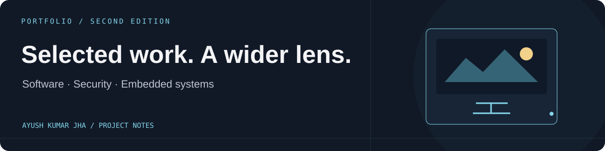

# Selected Works
### Ayush Kumar Jha · Portfolio 2.0

[Open the portfolio](https://ayush-kumar-jha-v2.onrender.com/) · [View CV](CV.pdf)

A static portfolio bringing together software projects, security coursework, embedded experiments, certificates, and technical community work.

**HTML · CSS · JavaScript · Canvas**

## Design

A signature introduction leads into a portrait reveal and scroll-driven project chapters. Project stories sit alongside their source and demo links, followed by credentials and presentation photographs.

The interface includes responsive navigation, a skip link, reduced-motion support, and a replayable introduction. Project illustrations are visual concepts rather than screenshots of running products.

## Run locally

```sh
git clone https://github.com/AyushKJha/profile-2.0.git
cd profile-2.0
python -m http.server 8003 --bind 127.0.0.1
```

Open http://localhost:8003. No dependencies or build step are required.

## Make changes

| File | Edit here for |
| --- | --- |
| [index.html](index.html) | Biography, projects, education, certificates, and links |
| [style.css](style.css) | Typography, colors, and layout |
| [script.js](script.js) | Introduction, scroll effects, canvas, and menu |
| [CV.pdf](CV.pdf) | Downloadable CV |
| [OFL-Allura.txt](OFL-Allura.txt) | Bundled font license |

## Hosting

The current Render static site publishes the repository root. It uses no API keys, accounts, or database. Certificate and demo links retain their external sharing settings.

Personal photographs and the CV are not covered by the bundled font's license.

[GitHub profile](https://github.com/AyushKJha) · [Earlier React portfolio](https://github.com/AyushKJha/ayush-portfolio)
